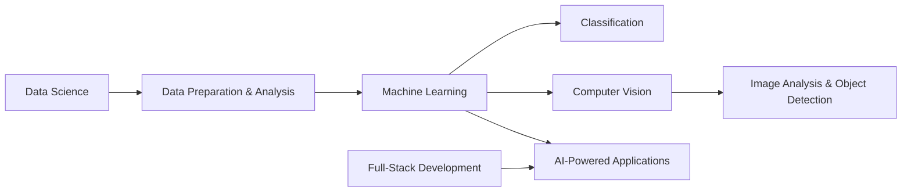

# Debangshini Bhattacharjee

---

## About

I’m pursuing a B.Tech in Computer Science at Sharda University. I’m interested in building a strong foundation across software engineering, machine learning, and data science, and in applying these skills to practical problems. I enjoy learning new technologies, collaborating with others, and steadily improving through hands-on work.

| Focus | What I’m working toward |
|:--|:--|
| **AI & machine learning** | Understanding models and applying them to practical tasks |
| **Data science** | Strengthening data handling and analytical problem solving |
| **Software development** | Building reliable web, mobile, and backend foundations |

**Open to:** internships, collaboration, and early-career opportunities.

## Technical toolkit

### Languages & application development

  
  
  
  
  
  
  
  
  
  
  
  

### AI, machine learning & data science

- **Machine learning:** supervised learning, classification, Random Forest, model training
- **Computer vision:** image analysis, object detection, hand-gesture recognition, MediaPipe, YOLO
- **AI:** generative AI tools, prompt engineering, AI-powered application development
- **Data:** data handling, SQL, MySQL, data-driven problem solving, database fundamentals

### Tools & foundations

`Git` · `GitHub` · `VS Code` · `Supabase` · `DSA` · `OOP` · `DBMS` · `Operating Systems` · `Computer Networks` · `Software Testing`

## How my interests connect

## A milestone worth celebrating

<table>
  <tr>
    <td align="center">
      
        
      <strong>Second Prize · Xebia Hackathon</strong>
       
      A proud milestone in my learning and building journey.
    </td>
  </tr>
</table>

## GitHub at a glance

  
  

  

---

  <i>“The general who wins a battle makes many calculations in his temple ere the battle is fought.”</i> — Sun Tzu, <i>The Art of War</i>, Chapter 1

